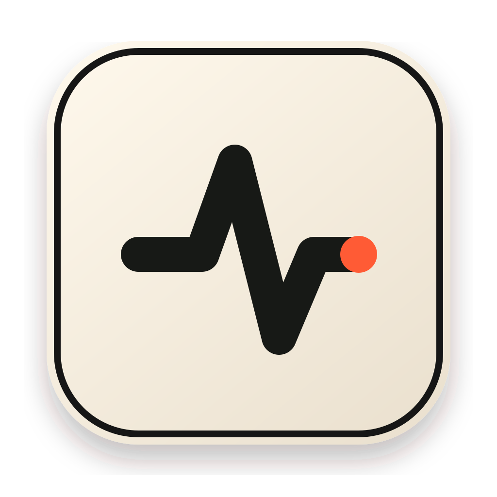

<div align="center">
  
  <h1>Alive</h1>
  <p><strong>Let the agents cook.</strong></p>
  <p>A tiny native macOS menu-bar app that keeps your Mac awake while Claude Code and Codex are working.</p>
  <p>
    <a href="https://github.com/kgoedecke/alive-app/releases/latest">Download</a> ·
    <a href="https://alive-site-production.up.railway.app">Website</a> ·
    <a href="CONTRIBUTING.md">Contribute</a>
  </p>
</div>

## Why Alive?

Long-running coding-agent sessions can be interrupted when macOS goes to sleep. Alive watches for local Claude Code and Codex processes, creates a native macOS power assertion while either agent is running, and releases it as soon as they finish.

- Automatic detection for Claude Code and OpenAI Codex
- Manual keep-awake override
- Optional display-sleep prevention
- Launch at login
- Native Swift and AppKit; no Electron runtime
- No accounts, analytics, network requests, or collected data
- MIT licensed and fully auditable

## Install

1. Download `Alive.zip` from the [latest release](https://github.com/kgoedecke/alive-app/releases/latest).
2. Unzip it and move `Alive.app` to `/Applications`.
3. Open Alive. Its pulse icon appears in the menu bar.

Public builds are currently ad-hoc signed, not notarized with a paid Apple Developer certificate. On first launch, macOS may ask you to confirm the app in **System Settings → Privacy & Security**. You can always build from source instead.

## Build from source

Requirements: macOS 13 or newer and Xcode 15+ or the matching Command Line Tools.

```sh
git clone https://github.com/kgoedecke/alive-app.git
cd alive-app
swift test
scripts/make_release.sh
open build/Alive.app
```

The release script produces `build/Alive.app` and `build/Alive.zip`. To produce a universal build on a machine with the full macOS SDK:

```sh
ALIVE_ARCHES="arm64 x86_64" scripts/make_release.sh
```

## How it works

Alive polls the local process table for the executable names used by Claude Code and Codex. When a supported agent is found, it creates `PreventUserIdleSystemSleep` and, if enabled, `NoDisplaySleep` assertions through IOKit. It does not inspect terminal contents, prompts, project files, or network traffic.

The app is organized as a Swift Package:

- `Sources/AliveCore` contains process parsing and state logic.
- `Sources/Alive` contains the native menu-bar UI, settings, login-item integration, and power assertions.
- `site` contains the dependency-free marketing site published with GitHub Pages.
- `scripts` contains deterministic icon, app-bundle, and release packaging tasks.

## Development

```sh
swift build --product Alive
swift test
scripts/package_app.sh
```

The marketing site can be previewed locally with any static server:

```sh
python3 -m http.server 4173 -d site
```

See [CONTRIBUTING.md](CONTRIBUTING.md) for the project workflow and [SECURITY.md](SECURITY.md) for responsible vulnerability reporting.

## License

Alive is available under the [MIT License](LICENSE).
